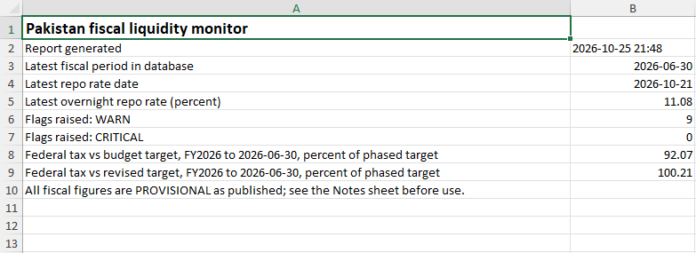
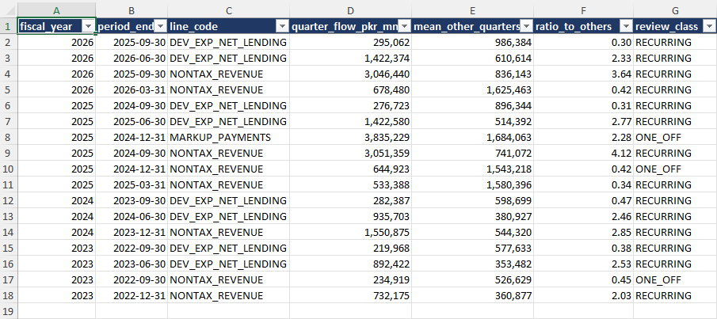
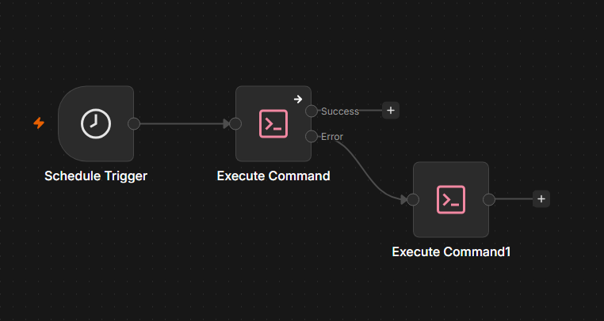
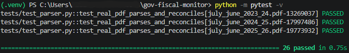

# 🏛️ Automated Government Fiscal Budget Liquidity Monitor — Pakistan


---

# 📖 Project Overview

This project is an automated data pipeline that tracks Pakistan's consolidated fiscal position and flags revenue shortfalls, slow development spending, a rising interest burden and a weakening primary balance. It pulls public data from the State Bank of Pakistan (SBP) and the Ministry of Finance, loads it into SQL Server, checks it, applies four rules, writes an Excel report and runs on a daily schedule through n8n.

The pipeline covers the full lifecycle: data extraction → PDF parsing → reconciliation checks → SQL warehouse → rule engine → Excel reporting → scheduling and alerts → automated tests.

This project includes:

- 📥 API extraction (SBP EasyData) and PDF table extraction (Ministry of Finance fiscal operations)
- ✅ Nine accounting-identity checks on every fiscal load, with a unit guard
- 🗄️ A SQL Server warehouse that keeps every published version of a figure
- 🚦 Four fiscal early-warning rules with thresholds stored in a table
- 📊 A multi-sheet Excel report, including a backtest and a notes sheet
- ⏰ n8n scheduling with a failure branch that writes an alert log
- 🧪 26 automated tests, including tests that run the real insert statements

---

## ⚠️ Read This First: What the Project Does and Does Not Show

- It is a **screening tool, not a forecast.** The rules compare the current position with a target or with the same period last year. Nothing here has been shown to predict anything.
- **Four fiscal years are loaded (FY2022-23 to FY2025-26).** Rule R1 needs the previous year to phase its target, so it can run on three of them.
- R1 flagged both years that ended below the original federal tax target and stayed quiet at the 95% line in the one year that nearly met its target. That is **three observations**, so no error rate can be estimated and the thresholds are not tuned.
- R3 fired once on real data. R2 and R4 have not fired on real data. All four rules were also run on constructed scenarios, which tests the arithmetic and not real-world performance.
- The fiscal figures are the **latest published versions, not what was known at the time**, and the publisher labels them **Provisional**.
- Table 1 is **consolidated federal and provincial**. Budget targets are **federal only** (see *Targets and the Comparison*).

---

## 📂 Data Sources

| Data | Source | Frequency | Unit |
|---|---|---|---|
| Overnight repo rate (`TS_GP_IR_REPOMR_D.ORR`) | [SBP EasyData](https://easydata.sbp.org.pk) API | Daily, since 25 May 2015 | Percent |
| Summary of Consolidated Federal and Provincial Fiscal Operations, Table 1 | [Ministry of Finance, Fiscal Operations](https://www.finance.gov.pk/fiscal_main.html) (PDF) | Cumulative from 1 July, reported at Sep, Dec, Mar, Jun | PKR million |
| Federal tax (FBR taxes) budget and revised estimates | Annual Budget Statements and Budget in Brief, Finance Division (PDF) | Annual | PKR million |

Notes on the data:
- Fiscal figures are stored **cumulative, exactly as published**. Quarterly flows are derived by subtraction in SQL.
- `fiscal_year` is the year in which the fiscal year ends (2026 means FY2025-26).
- Table 1 excludes inter-governmental account balances, as its own footnotes state.
- The EasyData API answered the default Python user agent with HTTP 403 during development, so the client sends a browser-style `User-Agent` header. Check SBP's terms of use before redistributing any data.
- EasyData's public finance datasets that were checked are annual, which is why the fiscal engine is quarterly, driven by the Ministry of Finance report.
- The Ministry of Finance PDFs have to be downloaded by hand into `data/raw/`. No automated download has been tested.

---

## 🛠 Tech Stack

| Tool | Purpose |
|------|----------|
| 🐍 Python 3.11 | Pipeline code |
| 🐼 pandas | Data handling |
| 📄 pdfplumber | PDF table extraction |
| 🔌 pyodbc | SQL Server connection |
| 🗄️ SQL Server (T-SQL views) | Warehouse and rule logic |
| 📊 openpyxl | Excel report |
| 🌐 requests | SBP EasyData API client |
| ⏰ n8n | Scheduling and failure branch |
| 🧪 pytest | Automated tests |
| 🔐 python-dotenv | Secrets kept in `.env` |

---

## 📸 Preview

### 📊 Excel Report: Summary



### 🚦 Excel Report: Flags



### ⏰ n8n Workflow (schedule, pipeline run, failure branch)



### 🧪 Test Results



---

## 🏗 Architecture

```text
n8n schedule (daily, 6pm Asia/Karachi)
    -> src/run_pipeline.py
         1. market data: SBP EasyData -> market_observation
         2. fiscal data: data/raw/july_june_*.pdf -> parse -> reconcile -> fiscal_cumulative
         3. report: SQL views -> reports/fiscal_report_<date>.xlsx
    -> on failure: exit code 1 -> n8n error branch -> logs/alerts.log
```

| Module | Purpose |
|---|---|
| `src/db.py` | SQL Server connection (credentials stay in `.env`) |
| `src/sbp_client.py` | EasyData client; validates the response shape and keeps the API key out of error messages |
| `src/load_market.py` | Loads each series; re-reads the last 30 days so revisions are caught; inserts only new or changed values |
| `src/parse_fiscal.py` | Extracts Table 1 from the PDF text, repairs split-digit numbers, checks the unit, runs 9 reconciliation identities |
| `src/load_fiscal.py` | Stores check results, refuses to load if any check fails, inserts only new or changed values |
| `src/build_report.py` | Writes the Excel workbook |
| `src/run_pipeline.py` | Single entry point; one failing step does not stop the others; exits 1 if anything failed |
| `src/log_alert.py` | Appends a line to `logs/alerts.log` for the n8n failure branch |
| `scripts/start_n8n.ps1` | Starts n8n with the Execute Command node enabled |

---

## 🗄 Database Design

Run the scripts in `sql/` in order, in SSMS: `01_schema.sql` to `11_register_series.sql`. Some scripts replace earlier objects (`02` drops `fiscal_actual`, `04` recreates `fiscal_target`), so run them on an empty database in sequence. The `flag` table created in `01` is not used.

- **Tables:** `etl_run_log`, `dim_series`, `market_observation`, `dim_fiscal_line`, `fiscal_cumulative`, `fiscal_target`, `dq_check_result`, `rule_def`
- **Views:** `vw_fiscal_quarterly`, `vw_r1_pace`, `vw_rule_metrics`, `vw_fiscal_flags`, `vw_fiscal_flow_review`

Design choices:
- **Nothing is overwritten.** Every fact carries `run_id` and `loaded_at`. When a provisional figure is later revised, the new value is added as a new row and the old one stays.
- **Loads are safe to re-run.** A row is inserted only if it is new or differs from the latest stored value.
- **Units are guarded.** The parser refuses a file whose header does not say "In Million of Pakistan Rupees".
- **Thresholds live in a table** (`rule_def`), not in code.

---

## ✅ Data-Quality Checks

Every fiscal load runs nine identities and stores the result in `dq_check_result`:

1. revenue = tax + non-tax
2. tax = federal + provincial
3. non-tax = federal + provincial
4. expenditure = current + development + statistical discrepancy
5. overall balance = revenue − expenditure
6. primary balance = overall balance + mark-up payments
7. financing = −overall balance
8. financing = external + domestic
9. domestic = non-bank + bank + privatization

The tolerance is 2 PKR million, because the publications contain rounding differences of 1. A load that fails any check is refused. A separate view flags unusual quarterly flows **for review, without changing the data**.

---

## 🚦 Rules

| Rule | Measures | Fires when |
|---|---|---|
| **R1** Revenue pace | Federal tax against the annual target, phased by the previous year's cumulative share | Below 95% (WARN) or 90% (CRITICAL) |
| **R2** Development pace | Cumulative development spending against the same period last year | Below 90% |
| **R3** Interest burden | Mark-up as a share of revenue, change against the same period last year | More than 5 points higher |
| **R4** Primary balance | Primary balance | Negative after being positive in the same period last year |

Phasing the target by the previous year's share is a **modelling assumption**, not a published schedule. Federal tax stayed close to 22%, 48% and 72% of the year at September, December and March in the years loaded.

### Targets and the Comparison

R1 compares Table 1's federal tax with the budget's FBR taxes. A partial view of the SBP Statistical Bulletin's federal revenue table suggests the two agree to rounding, but this was not checked in full, and they are related definitions, not formally identical. Both **original (BUDGET)** and **REVISED** targets are stored. The revised estimate is set with part of the year observed, so it is not an independent yardstick for early warning, and the BUDGET variant is the one the rule is judged on.

---

## 📊 Backtest (on the data loaded)

Federal tax as a percentage of the original target, phased by the previous year's share:

| Fiscal year | Sep | Dec | Mar | Jun | Outcome |
|---|---|---|---|---|---|
| FY2024 | 95.14 | 99.25 | 99.12 | 98.90 | Nearly met; no flag at 95% |
| FY2025 | 90.12 | 90.35 | 90.42 | 90.55 | Missed; WARN at every quarter |
| FY2026 | 93.53 | 91.03 | 91.50 | 92.07 | Missed; WARN at every quarter |

---

## 📌 Key Findings

- **Federal tax came in short of the original budget target in both of the last two years**: 90.55% in FY2025 and 92.07% in FY2026, with the shortfall visible from the first quarter. FY2024 nearly met its target (98.90%).
- **The R1 result depends on a threshold.** The eight missed-year quarters sit between 90.12 and 93.53, so any threshold above 93.53 flags all of them and any below 90.12 flags none. The lowest value is only 0.12 above the 90% critical line.
- **R3 fired once**, for the quarter ending 31 December 2023: mark-up payments rose from about 54.8% to 61.6% of revenue year on year (+6.81 points). The cause was not investigated.
- **Development spending is seasonal.** Its quarterly flow is low in July-September and high in April-June in all four years (ratio to the other quarters: 0.381 and 2.525 in FY2023, 0.472 and 2.456 in FY2024, 0.309 and 2.766 in FY2025, 0.299 and 2.329 in FY2026). The data shows the pattern but not its cause.
- **Some published figures are lumpy.** Mark-up payments in October-December 2024 were 3,835,229 million against about 1.3 million in the quarters either side. These match the PDF, so the pipeline flags them for review and does not alter them.
- **The large non-tax revenue quarter moves.** It falls in October-December in FY2023 and FY2024 and in July-September in FY2025 and FY2026.

---

## 💡 Recommendations

- Add a monthly source (for example FBR's monthly collection releases) for faster signals, since the Ministry of Finance report is quarterly.
- Compare federal development spending with a federal-only table (Table 4) before using a development-spending trigger against a federal budget figure.
- Keep every published version of a figure. Revisions and provisional labels matter for any backtest that claims to reflect what was known at the time.

---

## 📂 Repository Structure

```text
gov-fiscal-monitor/
├── data/raw/                # fiscal operations PDFs (git-ignored)
├── images/                  # screenshots used in this README
├── n8n/
│   └── fiscal_pipeline_workflow.json   # exported workflow (edit the paths on import)
├── reports/                 # generated Excel reports (git-ignored)
├── scripts/
│   └── start_n8n.ps1
├── sql/                     # 01_schema.sql ... 11_register_series.sql
├── src/
│   ├── db.py
│   ├── sbp_client.py
│   ├── load_market.py
│   ├── parse_fiscal.py
│   ├── load_fiscal.py
│   ├── build_report.py
│   ├── run_pipeline.py
│   └── log_alert.py
├── tests/
│   ├── conftest.py
│   ├── test_parser.py
│   └── test_loader_insert.py
├── .env                     # secrets (git-ignored)
├── .gitignore
├── requirements.txt
└── README.md
```

---

# 🚀 How to Run the Project

1. Install SQL Server (developed against a local instance), SSMS, ODBC Driver 18 for SQL Server, Python 3.11 and Node.js.

2. Clone this repository.

```powershell
git clone https://github.com/kazimalizaidi/gov-fiscal-monitor.git
cd gov-fiscal-monitor
```

3. Create the environment and install the libraries.

```powershell
python -m venv .venv
.venv\Scripts\activate
pip install -r requirements.txt
```

4. Create a `.env` file in the project root (it is git-ignored). Get an API key from the EasyData site.

```text
DB_SERVER=localhost
DB_NAME=FiscalMonitor
EASYDATA_API_KEY=your_key_here
```

5. Create the database `FiscalMonitor` and run `sql/01` to `sql/11` in order, in SSMS.

6. Download the fiscal operations PDFs into `data/raw/`, named `july_june_YYYY_YY.pdf` (for example `july_june_2025_26.pdf`).

7. Check that the repo-rate series was registered by `sql/11_register_series.sql`: `SELECT * FROM dbo.dim_series;` should return one row.

8. Run everything once.

```powershell
python src/run_pipeline.py
```

---

## ⏰ Scheduling with n8n

- Start n8n with `scripts/start_n8n.ps1`. n8n 2.x disables the Execute Command node by default, so the script sets `NODES_EXCLUDE` to keep only the local-file trigger blocked. This lets n8n run shell commands, which is a security trade-off on a shared machine.
- The workflow is a Schedule Trigger (daily, 6pm, Asia/Karachi) followed by an Execute Command node running `run_pipeline.py`. The node's On Error setting is "Continue (using error output)", and the error output runs `src/log_alert.py`. Import `n8n/fiscal_pipeline_workflow.json` and replace `<PROJECT_ROOT>` in the two commands with your project path.
- Tested with n8n 2.44.6. Running n8n outside a container is flagged as deprecated in that version.

Limits of the scheduling:
- It only fires while the computer is on and n8n is running. There is no alert if n8n itself is not running.
- A missed day is recovered on the next run for market data (30-day re-read), but no report is produced for the missed days.
- Once errors are routed to the error output, n8n may record a failed run as a successful execution. The real record is `etl_run_log` and `logs/alerts.log`.
- `run_id` values have gaps (SQL Server skips identity values after a restart, and each test run uses one).

---

## 🧪 Tests

```powershell
python -m pytest -v
```

26 tests cover:
- the parser's number repair (including the split-digit patterns found in the FY2022-23 PDF), label matching, the reconciliation checks and their tolerance, and the unit guard
- the four real PDFs, each parsed and reconciled against its full-year revenue total (skipped if a file is missing)
- the real insert and lookup statements used by both loaders, run inside a transaction that is rolled back (skipped if the database is unreachable)

---

# 📌 Future Improvements

- Automated download of the Ministry of Finance PDFs 
- A monthly collection source for faster signals
- Federal-only comparisons using Table 4, and provincial detail from Table 5
- More fiscal years, so thresholds can be reviewed against more than three observations
- Storing figures as first published, for a true point-in-time backtest
- Auto-start of n8n at login and a heartbeat alert if the schedule stops firing
- A GitHub Actions workflow that runs the parser tests on every push

---

# 📚 References & Data Sources

- **SBP EasyData:** [easydata.sbp.org.pk](https://easydata.sbp.org.pk)
- **Fiscal operations (Table 1):** [Ministry of Finance, Fiscal Operations](https://www.finance.gov.pk/fiscal_main.html)
- **FY2025-26 Annual Budget Statement:** [finance.gov.pk](https://www.finance.gov.pk/budget/budget_2025_26/abs_eng_10062025.pdf)
- **FY2024-25 Annual Budget Statement:** [finance.gov.pk](https://finance.gov.pk/budget/Budget_2024_25/Annual_Budget_Statement.pdf)
- **Budget in Brief 2026-27 (contains the original FY2025-26 budget):** [finance.gov.pk](https://www.finance.gov.pk/budget/budget_2026_27/Budget_in_Brief.pdf)

---

# 🎧 Project Soundtrack

*This track was on loop while working on this project*

[when i close my eyes - Lonnex](https://open.spotify.com/track/3yhtzhGYHo3IFzgZNiO0Dz?si=014f450f61e74d87)

**Star this repository if you found it interesting!** ⭐

made with ❤️ by **kazim**
